# Plugin README banner artwork

Created 8 November 2026 with the built-in `image_gen` tool. The 14 new banners extend each plugin’s existing marketplace palette and icon motifs. Generated PNGs were reduced with native macOS `sips -Z 1536` to 1536 × 512 pixels; original marketplace icons and logos remain unchanged.

Local Translation retains its existing [banner and prompt record](2026-10-28-local-translation.md). Camofox retains its existing `assets/readme-banner.svg`; this change links that artwork from its README without changing the artwork.

The following are the actual generation prompts. The built-in tool determines its output dimensions; final images were inspected for title/subtitle accuracy, margins, contrast and correspondence with the existing identity.

## Banner gallery

| Plugin | README banner |
| --- | --- |
| [Project Delivery](../../plugins/project-delivery/README.md) | 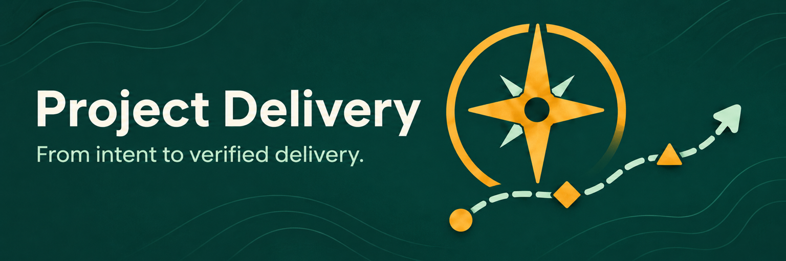 |
| [Conversation Visuals](../../plugins/conversation-visuals/README.md) | 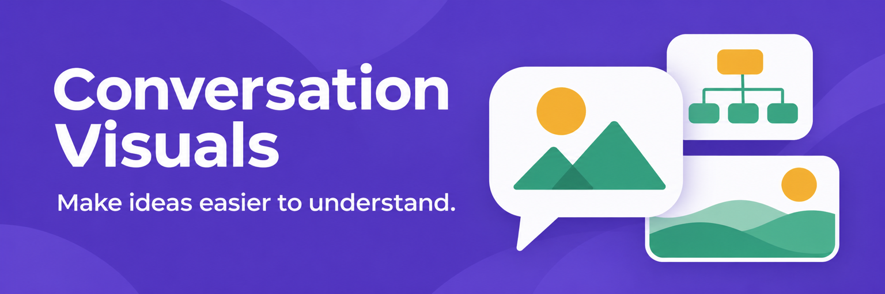 |
| [MLX Optimizer](../../plugins/mlx-optimizer/README.md) | 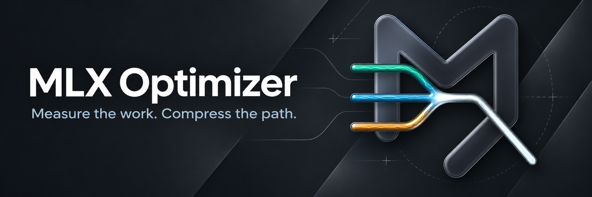 |
| [Semantic Versioning](../../plugins/semantic-versioning/README.md) | 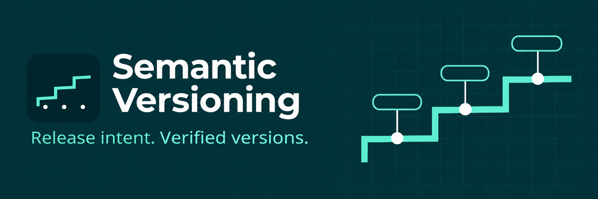 |
| [iCloud Mail](../../plugins/icloud-mail/README.md) |  |
| [Build Multi-target Tauri Apps](../../plugins/build-multi-target-tauri-apps/README.md) | 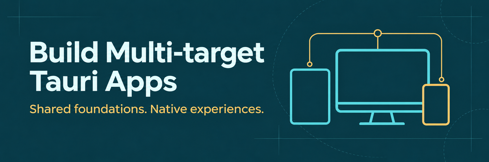 |
| [Iterating PR Bot Fixes](../../plugins/iterating-pr-bot-fixes/README.md) | 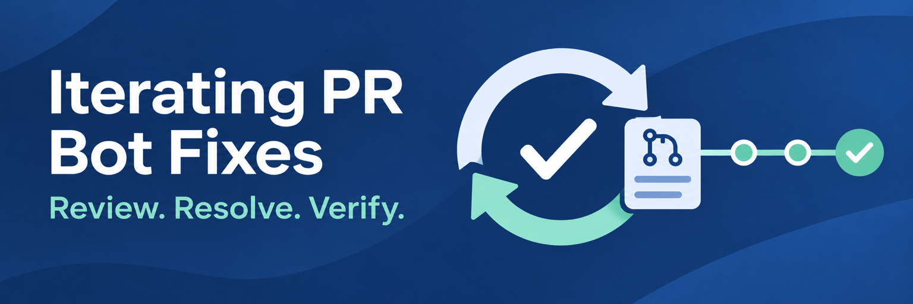 |
| [Repository Consolidation](../../plugins/repo-consolidation/README.md) | 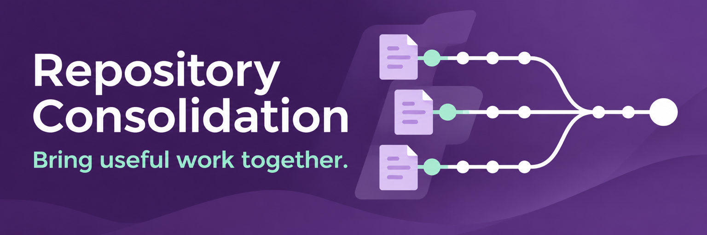 |
| [Conventional Commit](../../plugins/conventional-commit/README.md) | 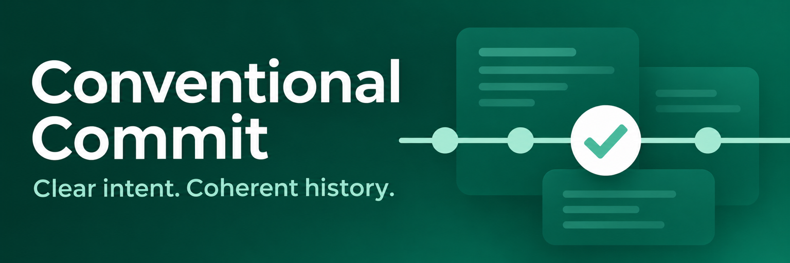 |
| [Simplify Code](../../plugins/simplify-code/README.md) | 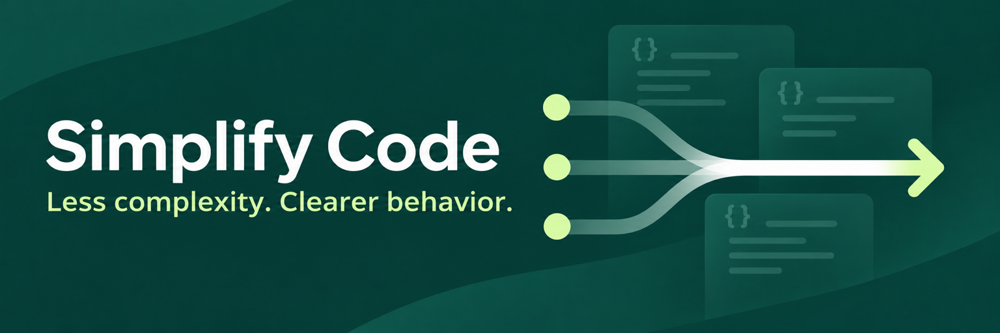 |
| [Adversarial Audit](../../plugins/adversarial-audit/README.md) | 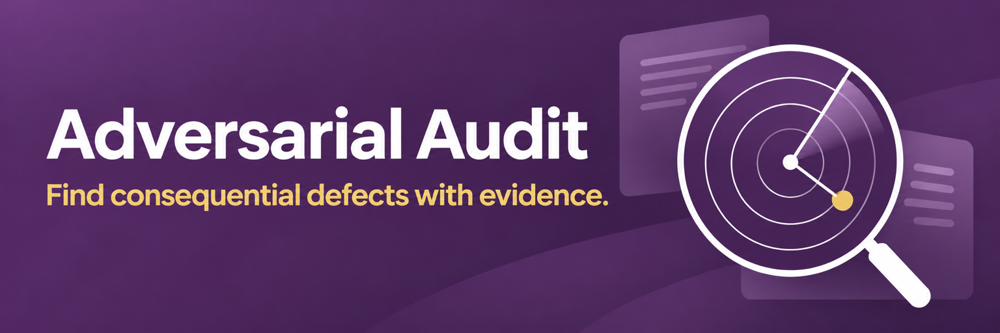 |
| [Web Research](../../plugins/web-research/README.md) | 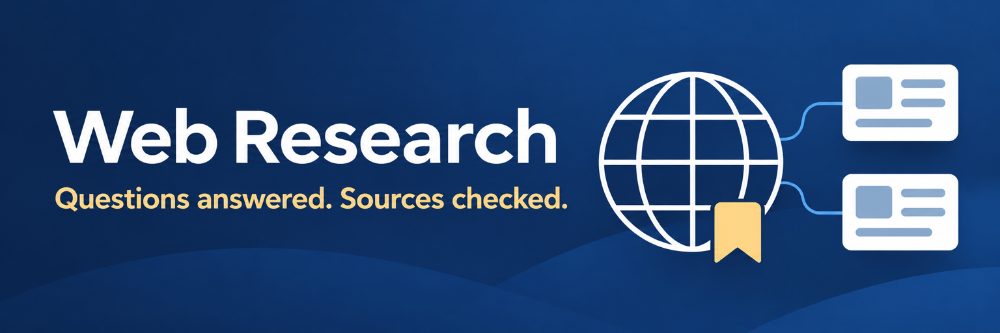 |
| [Repository Guidance](../../plugins/repository-guidance/README.md) | 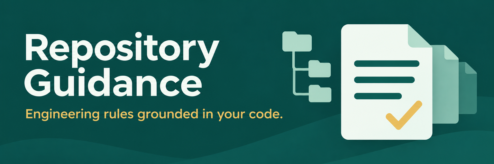 |
| [Camofox Browser](../../plugins/camofox-mcp/README.md) | 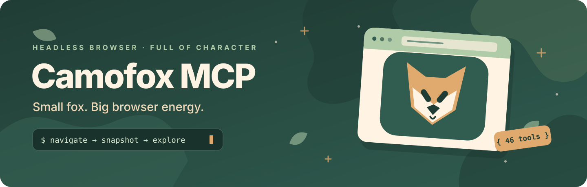 |
| [Local Translation](../../plugins/local-translation/README.md) | 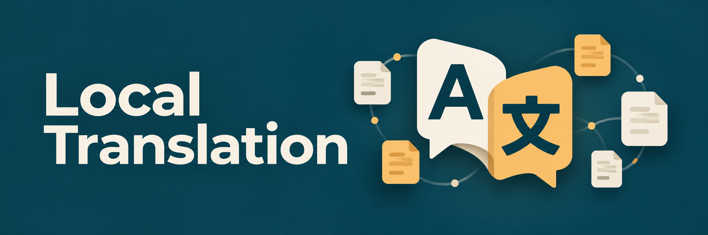 |
| [Mindrally Skills](../../plugins/mindrally-skills/README.md) | 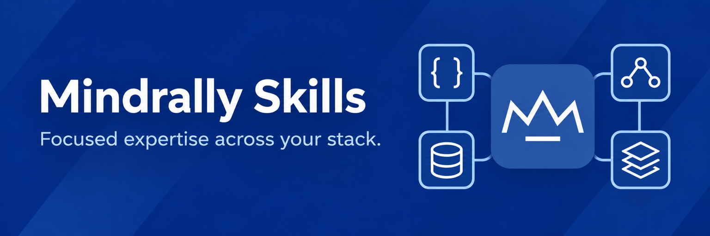 |

## Generation prompts

Project Delivery used `plugins/project-delivery/assets/project-delivery-logo.png`
as its image reference; MLX Optimizer used
`plugins/mlx-optimizer/assets/mlx-optimizer-logo.png`. The other new banners used
the existing SVG icon shapes and manifest palettes described in their prompts.

## adversarial-audit

Final file: `plugins/adversarial-audit/assets/readme-banner.png`

```text
Use case: ads-marketing. Asset type: a finished horizontal README top banner for a professional developer-tool plugin, opaque, 1536 x 512 pixels, 3:1 aspect ratio. Style/medium: restrained sophisticated editorial flat vector-like illustration, crisp deliberate white modern sans-serif typography, meticulous generous spacing, subtle layered tonal surfaces and minimal gradient background, competent expert tone. Composition: plugin name on left half in large legible type, wrap into two lines if needed; exact subtitle below in smaller accent-color type; right half purposeful visual extending existing icon. Leave generous edge clearance. Render ONLY exact title and subtitle; no extra text. Avoid neon, photorealism, robots, glossy 3D, busy dashboards, microtext, invented certifications, third-party marks, dates, versions, watermarks. Primary request: banner for Adversarial Audit. Text (verbatim): title 'Adversarial Audit' and subtitle 'Find consequential defects with evidence.'. Brand palette: violet #8D3D9E, white and pale gold #FFE28B. Existing icon: white concentric radar circles, two precise sweep arms, center dot, one gold finding dot, with a magnifying-glass handle at lower right. Right-hand composition: a beautiful precise radar lens with concentric white rings, one gold evidence point being examined, understated document/evidence planes behind. Dark plum backdrop with a muted violet gradient. Communicate scientific scrutiny and calm rigor; no alarms, skulls, hackers, shields, or fear imagery.
```

## build-multi-target-tauri-apps

Final file: `plugins/build-multi-target-tauri-apps/assets/readme-banner.png`

```text
Use case: ads-marketing. Asset type: final README top banner for a professional developer plugin. Output a single opaque horizontal image, exactly 1536 by 512 pixels (3:1). Sophisticated flat editorial vector-like artwork with precise geometry, crisp sans-serif typography, understated subtle tonal background, generous margins of at least 65 pixels. One coherent image, not a mockup. Left 54 percent is title and one subtitle; right 46 percent is purposeful functional illustration. Strong hierarchy, calm competence, polished professional visual identity. No neon, glossy 3D, photo, mascots, gibberish code, fake dashboards, dates, version numbers, certifications, external logos or watermarks. Render only the exact supplied title and subtitle, with no other text. Existing original brand palette: very dark teal #103B49, cyan #77D9DA, warm gold #F7C66C. Existing icon is an outlined cyan desktop monitor with rectangular screen and stand, with a small gold outlined phone overlapping its lower right. Carry that exact visual vocabulary into the composition, depicting a desktop monitor, tablet and phone sharing a coherent simple application geometry through neat connecting lines; no branded device markings. Architectural precision and restrained clear lines, faint engineering-layout background accents. Exact title: "Build Multi-target Tauri Apps" on two balanced lines. Exact subtitle: "Shared foundations. Native experiences." Light cyan-white title and restrained warm gold accent.
```

## conventional-commit

Final file: `plugins/conventional-commit/assets/readme-banner.png`

```text
Use case: ads-marketing. Asset type: a finished horizontal README top banner for a professional developer-tool plugin, opaque, 1536 x 512 pixels, 3:1 aspect ratio. Primary request: create a restrained sophisticated editorial illustration and typographic banner for Conventional Commit. Existing brand identity to preserve: deep emerald #157862, pale mint #BCECDC, white; icon is a white circular commit node intersecting a horizontal pale-mint Git line, with a mint checkmark inside the circle. Composition: left half large beautifully kerned white modern sans-serif title, exact text 'Conventional Commit' across two lines if necessary; below it smaller mint subtitle exact text 'Clear intent. Coherent history.' Right half expands the original commit-node/checkmark motif into a clear horizontal Git history with a single prominent selected verified node, subtle understated code-document tiles behind it. Clean flat vector-like geometry, crisp strokes, subtle depth from layered tonal emerald surfaces, meticulous spacing, quiet competent expert tone. Minimal tonal gradient background from dark forest to brand emerald. All content has generous edge clearance; legible at README width. Avoid neon, photorealism, robots, glossy 3D objects, busy dashboards, random symbols, microtext, badges, extra words, certifications, third-party marks, version numbers, watermarks. Render only the exact title and subtitle.
```

## conversation-visuals

Final file: `plugins/conversation-visuals/assets/readme-banner.png`

```text
Use case: ads-marketing. Asset type: final README top banner for a professional developer plugin. Output a single opaque horizontal image, exactly 1536 by 512 pixels (3:1). Sophisticated flat editorial vector-like artwork with precise geometry, crisp sans-serif typography, understated subtle tonal background, generous margins of at least 65 pixels. One coherent image, not a mockup. Left 54 percent is title and one subtitle; right 46 percent is purposeful functional illustration. Strong hierarchy, calm competence, polished professional visual identity. No neon, glossy 3D, photo, mascots, gibberish code, fake dashboards, dates, version numbers, certifications, external logos or watermarks. Render only the exact supplied title and subtitle, with no other text. Existing original brand palette: violet #5B43D6, white, golden sun #F6B73C, green #32A88B. Existing icon is a white speech bubble containing a golden circular sun and green geometric mountains. Preserve this visual identity and extend the speech-picture motif into an elegant arrangement of overlapping visual explanation panels: a large white speech-picture bubble, small minimalist branching diagram panel, and visual landscape panel. No generic AI art. Use a deep violet backdrop with slightly lighter violet tonal geometry and restrained gold/green details. Exact title: "Conversation Visuals" on two balanced lines if needed. Exact subtitle: "Make ideas easier to understand."
```

## icloud-mail

Final file: `plugins/icloud-mail/assets/readme-banner.png`

```text
Use case: ads-marketing. Asset type: final README top banner for a professional developer plugin. Output one opaque wide horizontal image, 1536 by 512 pixels, 3:1 aspect ratio. Sophisticated restrained flat editorial vector-like artwork with precise geometry, crisp sans-serif typography, subtle tonal background, generous margins of at least 65 pixels. One coherent image, not a mockup. Left 54 percent is title and one subtitle; right 46 percent is purposeful functional illustration. Strong hierarchy, calm competence, polished professional visual identity. No neon, glossy 3D, photorealism, mascots, gibberish code, fake dashboards, dates, version numbers, certifications, external logos or watermarks. Render only exact supplied title and subtitle, with no other text. Existing original icon: bright sky-blue rounded square with a white cloud behind a white envelope; envelope blue outline and downward V flap. Original palette deep navy #09285B, bright sky #1687F8, cyan #63D4FF, white and pale blue. Extend this visual vocabulary into an elegant central cloud-and-envelope illustration at right, with a few orderly envelope/document cards arranged through fine connecting lines suggesting an organized connected mailbox. Keep it calm and professional, no badge counts or fake UI. Deep navy tonal backdrop with subtle wide arcs, crisp white title, pale blue subtitle, restrained cyan accents. Exact title: "iCloud Mail". Exact subtitle: "Your mailbox, thoughtfully connected."
```

## iterating-pr-bot-fixes

Final file: `plugins/iterating-pr-bot-fixes/assets/readme-banner.png`

```text
Use case: ads-marketing. Asset type: a finished horizontal README top banner for a professional developer-tool plugin, opaque, 1536 x 512 pixels, 3:1 aspect ratio. Style/medium: restrained sophisticated editorial flat vector-like illustration, crisp deliberate white modern sans-serif typography, meticulous generous spacing, subtle layered tonal surfaces and minimal gradient background, competent expert tone. Composition: plugin name on left half in large legible type, wrap into two lines if needed; exact subtitle below in smaller accent-color type; right half purposeful visual extending existing icon. Leave generous edge clearance. Render ONLY exact title and subtitle; no extra text. Avoid neon, photorealism, robots, glossy 3D, busy dashboards, microtext, invented certifications, third-party marks, dates, versions, watermarks. Primary request: banner for Iterating PR Bot Fixes. Text (verbatim): title 'Iterating PR Bot Fixes' and subtitle 'Review. Resolve. Verify.'. Brand palette: deep blue #2459A6, pale ice #EAF1FF, mint #9EE7D2 and white. Existing icon: two circular curved arrows, upper ice and lower mint, forming an iteration cycle around a white checkmark. Right-hand composition: large clean circular review arrows embracing a precise checkmark and small understated pull-request document tile; a short sequence of connected review nodes leading to a settled verified result. Dark navy-to-brand-blue backdrop. No bot character.
```

## mindrally-skills

Final file: `plugins/mindrally-skills/assets/readme-banner.png`

```text
Use case: ads-marketing. Asset type: final README top banner for a professional developer plugin. Output one opaque wide horizontal image, 1536 by 512 pixels, 3:1 aspect ratio. Sophisticated restrained flat editorial vector-like artwork with precise geometry, crisp sans-serif typography, subtle tonal background, generous margins of at least 65 pixels. One coherent image, not a mockup. Left 54 percent is title and one subtitle; right 46 percent is purposeful functional illustration. Strong hierarchy, calm competence, polished professional visual identity. No neon, glossy 3D, photorealism, mascots, gibberish code, fake dashboards, dates, version numbers, certifications, external logos or watermarks. Render only exact supplied title and subtitle, with no other text. Existing original icon: rounded blue square #345A9C with a white continuous angular crown-like M composed of three upward peaks and a short horizontal white baseline beneath the center. Preserve that distinct angular white M/crown symbol prominently in an elegant blue tile at right, surrounded by a small orderly library of blue/white outlined capability tiles using only simple unbranded geometric bracket, network, database cylinder, and layer-stack symbols. Depict focused expertise assembled into a coherent toolkit, not a large dashboard or random icons. Use deep cobalt-blue tonal background with primary blue #345A9C, pale blue and white accents, restrained geometry. Exact title: "Mindrally Skills". Exact subtitle: "Focused expertise across your stack."
```

## mlx-optimizer

Final file: `plugins/mlx-optimizer/assets/readme-banner.png`

```text
Use case: ads-marketing. Asset type: professional open-source plugin README top banner, very wide horizontal 3:1 composition approximately 1536x512 pixels, opaque.
Create an exceptionally polished brand banner for "MLX Optimizer" using attached original icon as visual identity reference. Preserve its graphite #13171A, mint/cyan/amber compute rails converging into one white verified fast path, and dark sculpted angular M/abstract x design language. It is a Python-first MLX performance engineering tool; convey careful measurement, efficient computation and professional expertise in Apple Silicon optimization without using any Apple or third-party logo.
Composition: restrained technical editorial design, subtle charcoal graphite background, left 48% clear large modern sans serif typography with generous margins, right half the reference's dark metallic angular M structure with three precise mint, cyan and amber compute paths converging into a single white result rail, elegant engineering diagram hints but no fake data. Large accurate text on left, verbatim: "MLX Optimizer". Beneath smaller text, verbatim: "Measure the work. Compress the path." White title, subtle pale blue-grey subtitle. Material depth should match original icon but avoid dramatic lightning or excessive glow; the paths are crisp refined inlays, sophistication over spectacle. No other text, no dates, no versions, no badges, no fake numbers, no chips with Apple branding, no watermark. Whole image feels competent, precise and professional, designed for a GitHub README at 900px display width.
```

## project-delivery

Final file: `plugins/project-delivery/assets/readme-banner.png`

```text
Use case: ads-marketing. Asset type: professional open-source plugin README top banner, very wide horizontal 3:1 composition approximately 1536x512 pixels, opaque.
Create an exceptionally polished brand banner for "Project Delivery" using the attached image as visual identity reference only. Preserve its emerald forest green #163F38, warm gold compass and pale mint dashed route-arrow design language. This is a software delivery orchestration tool: its distinctive compass and an intentional route through a few milestones should convey clarity, sound engineering judgement and delivery with evidence.
Composition: restrained editorial brand illustration, subtle deep forest background, left 48% clean typography and generous margins, right 45% refined compass illustration with an elegant mint route winding through three small geometric milestones. Large accurate text on left, verbatim: "Project Delivery". Below in much smaller crisp type, verbatim: "From intent to verified delivery." Typography is modern confident sans serif, cream/white title, pale mint subtitle, good contrast, spacious layout. Fine topographic contour arcs may echo navigation very subtly, never busy. Stay stylistically related to supplied gold compass mark, not a separate logo. Flat geometric illustration with very subtle depth and grain, premium technical editorial feel. No other text, no dates, no versions, no badges, no product logos, no fake charts, no neon, no decorative dashboard, no watermark. Whole image feels competent, calm and professional, designed for a GitHub README at 900px display width.
```

## repo-consolidation

Final file: `plugins/repo-consolidation/assets/readme-banner.png`

```text
Use case: ads-marketing. Asset type: a finished horizontal README top banner for a professional developer-tool plugin, opaque, 1536 x 512 pixels, 3:1 aspect ratio. Style/medium: restrained sophisticated editorial flat vector-like illustration, crisp deliberate white modern sans-serif typography, meticulous generous spacing, subtle layered tonal surfaces and minimal gradient background, competent expert tone. Composition: plugin name on left half in large legible type, wrap into two lines if needed; exact subtitle below in smaller accent-color type; right half purposeful visual extending existing icon. Leave generous edge clearance. Render ONLY exact title and subtitle; no extra text. Avoid neon, photorealism, robots, glossy 3D, busy dashboards, microtext, invented certifications, third-party marks, dates, versions, watermarks. Primary request: banner for Repository Consolidation. Text (verbatim): title 'Repository Consolidation' and subtitle 'Bring useful work together.'. Brand palette: purple #6B439A, pale lavender #EEE6FA, mint #AEE4D2 and white. Existing icon: three branch paths from mint circular nodes converge into one white final Git node. Right-hand composition: three tidy separate Git branch paths with clearly visible round commit nodes converge gracefully into one crisp shared trunk and prominent white endpoint, subtle lavender source-document planes behind. Dark aubergine-to-brand-purple backdrop. Visual should communicate organized reconciliation and preservation.
```

## repository-guidance

Final file: `plugins/repository-guidance/assets/readme-banner.png`

```text
Use case: ads-marketing. Asset type: a finished horizontal README top banner for a professional developer-tool plugin, opaque, 1536 x 512 pixels, 3:1 aspect ratio. Style/medium: restrained sophisticated editorial flat vector-like illustration, crisp deliberate white modern sans-serif typography, meticulous generous spacing, subtle layered tonal surfaces and minimal gradient background, competent expert tone. Composition: plugin name on left half in large legible type, wrap into two lines if needed; exact subtitle below in smaller accent-color type; right half purposeful visual extending existing icon. Leave generous edge clearance. Render ONLY exact title and subtitle; no extra text. Avoid neon, photorealism, robots, glossy 3D, busy dashboards, microtext, invented certifications, third-party marks, dates, versions, watermarks. Primary request: banner for Repository Guidance. Text (verbatim): title 'Repository Guidance' and subtitle 'Engineering rules grounded in your code.'. Brand palette: teal #1D766E, ivory #ECF8F3, pale sage #A9D8C6, restrained gold #E4B95E. Existing icon: ivory instruction document with folded upper-right corner, three teal text rules and a gold checkmark at lower right. Right-hand composition: prominent beautifully aligned folded-corner ivory instruction document, precise teal rules and gold checkmark, a subtle tidy repository tree and few understated document tabs behind it. Dark teal backdrop. Communicate grounded engineering guidance, clarity, and professional standards.
```

## semantic-versioning

Final file: `plugins/semantic-versioning/assets/readme-banner.png`

```text
Use case: ads-marketing. Asset type: final README top banner for a professional developer plugin. Output one opaque wide horizontal image, 1536 by 512 pixels, 3:1 aspect ratio. Sophisticated restrained flat editorial vector-like artwork with precise geometry, crisp sans-serif typography, subtle tonal background, generous margins of at least 65 pixels. One coherent image, not a mockup. Left 54 percent is title and one subtitle; right 46 percent is purposeful functional illustration. Strong hierarchy, calm competence, polished professional visual identity. No neon, glossy 3D, photorealism, mascots, gibberish code, fake dashboards, dates, version numbers, certifications, external logos or watermarks. Render only exact supplied title and subtitle, with no other text. Existing original icon: dark teal square #102E38 containing a mint #5DE1CA staircase line with exactly three rising stages and small white dots beneath the risers. Extend the distinctive three-stage staircase motif into an elegant release-progress illustration at right with three clearly ascending mint steps, small white checkpoint circles and restrained white/mint outlined release tags. Do not show numbers or words within the illustration. Deep teal background with a faint architectural grid at right only. White title and mint subtitle, crisp clear spacious typography. Exact title: "Semantic Versioning" on two balanced lines if needed. Exact subtitle: "Release intent. Verified versions."
```

## simplify-code

Final file: `plugins/simplify-code/assets/readme-banner.png`

```text
Use case: ads-marketing. Asset type: a finished horizontal README top banner for a professional developer-tool plugin, opaque, 1536 x 512 pixels, 3:1 aspect ratio. Style/medium: restrained sophisticated editorial flat vector-like illustration, crisp deliberate white modern sans-serif typography, meticulous generous spacing, subtle layered tonal surfaces and minimal gradient background, competent expert tone. Composition: plugin name on left half in large legible type, wrap into two lines if needed; exact subtitle below in smaller accent-color type; right half purposeful visual extending existing icon. Leave generous edge clearance. Render ONLY exact title and subtitle; no extra text. Avoid neon, photorealism, robots, glossy 3D, busy dashboards, microtext, invented certifications, third-party marks, dates, versions, watermarks. Primary request: banner for Simplify Code. Text (verbatim): title 'Simplify Code' and subtitle 'Less complexity. Clearer behavior.'. Brand palette: deep teal #19776A, white and light lime #DAF7B4. Existing icon: three lime input circles on left feed three white paths that merge into one right-pointing arrow. Right-hand composition: several softly subdued branching code paths resolve into a single clear bright white rail ending in a clean lime arrow, restrained overlapping code-document panels barely visible behind. Dark forest-teal backdrop. Elegant disciplined visual about reducing concepts.
```

## web-research

Final file: `plugins/web-research/assets/readme-banner.png`

```text
Use case: ads-marketing. Asset type: a finished horizontal README top banner for a professional developer-tool plugin, opaque, 1536 x 512 pixels, 3:1 aspect ratio. Style/medium: restrained sophisticated editorial flat vector-like illustration, crisp deliberate white modern sans-serif typography, meticulous generous spacing, subtle layered tonal surfaces and minimal gradient background, competent expert tone. Composition: plugin name on left half in large legible type, wrap into two lines if needed; exact subtitle below in smaller accent-color type; right half purposeful visual extending existing icon. Leave generous edge clearance. Render ONLY exact title and subtitle; no extra text. Avoid neon, photorealism, robots, glossy 3D, busy dashboards, microtext, invented certifications, third-party marks, dates, versions, watermarks. Primary request: banner for Web Research. Text (verbatim): title 'Web Research' and subtitle 'Questions answered. Sources checked.'. Brand palette: rich blue #245DA8, white and warm pale gold #FFE5A3. Existing icon: white wireframe globe with vertical meridian and horizontal latitude lines, small gold bookmark at lower right. Right-hand composition: large clean white wireframe globe paired with a crisp golden bookmark and two restrained source-document cards connected by thin fine blue evidence lines, not a busy network. Dark navy-to-brand-blue backdrop. Communicate careful source-led investigation and well-organized evidence.
```
