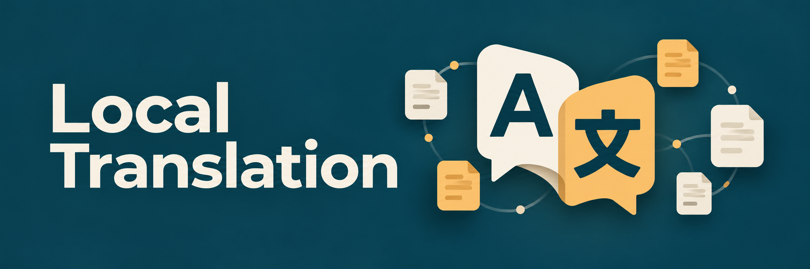

# Local Translation



Coordinate expert agents through translation, independent bilingual AI revision,
terminology and subject review, correction loops, and a human release decision.
The bundled local MCP tool drafts supported text into multiple target locales
using an explicitly configured Index-Translate deployment.

The [Translation Project coordinator](skills/translation-project/SKILL.md) assigns
work to nineteen separately invocable specialist skills. Each subagent loads its
assigned skill, acknowledges the remit and evidence gaps, follows that role's
working method, and returns an attributed handoff. The [role directory](skills/.shared/references/roles.md)
maps all sixteen whitepaper functions and the additional editing, proofreading,
media-coordination and conformance responsibilities to actual skills. Agents
exchange findings, replies and adjudications through the host's real
collaboration tools.

## Assign a specialist

Use `$local-translation:translation-project` for end-to-end coordination. The
coordinator commissions only the roles needed by the job, respecting host agent
slots; twenty available skills do not require twenty simultaneous agents.
Translator and independent reviser assignments for the same material must go to
different actual subagents.

Individual skills also work directly. For example:

> Use `$local-translation:bilingual-revision` to compare this French candidate
> against the approved English source, brief and glossary. Identify meaning and
> completeness errors, ask the translator to respond, and return the unresolved
> decisions with their evidence.

Each assignment names the installed role-skill path, owned locale and segments,
current artifact and shared-context identities, allowed tools, recipient and
stop conditions. A role-loading receipt shows which skill was read. Findings
then receive an actual counterpart response, adjudication where needed, and a
recheck. The [shared expert contract](skills/.shared/references/expert-contract.md)
and [handoff template](skills/.shared/templates/expert-handoff.md) define that
exchange once for every role.

Skills provide specialist procedures and decision support. They do not retrain
an agent, prove language/domain competence, or confer human qualifications.
Evaluate a representative pilot and the returned work; loading a role alone is
not a quality result. See the [role directory](skills/.shared/references/roles.md)
for all twenty entry points and their evidence requirements.

## Start a project

1. Install this package using your client's supported local marketplace/plugin
   flow. It ships portable Agent Plugins 1.0 components and the Codex overlay;
   client support and delegation capabilities differ.
2. Supply Python 3.11+, a local vLLM-compatible Index-Translate runner with model
   listing, chat completions and chat tokenization, and your own deployment config.
   Installation does not download weights or start inference.
3. Configure `LOCAL_TRANSLATION_ROOT` and `LOCAL_TRANSLATION_CONFIG` in the MCP
   process environment. Follow the [runtime guide](skills/.shared/references/runtime.md)
   for exact fields, supported sources and tool contracts. Codex forwards those
   two variables and optional `LOCAL_TRANSLATION_API_KEY` from its launch
   environment; use that credential name for `api_key_env` in Codex. Keep values
   out of plugin files and restart the client after changing its environment.
4. Invoke the skill with your source file, exact target locales, audience, approved
   resources and acceptance owner. Run a representative pilot before a large batch.

Example request:

> Use Translation Project to translate the approved UTF-8 guide in my configured
> workspace from en-US into fr-FR and de-DE. Use the approved UI terminology,
> assign a translator and a separate bilingual reviser for each locale, resolve
> shared questions through me, and prepare delivery candidates for my review.

The tool stores job artifacts beneath the configured workspace. Default status
omits source/target bodies and free-text review context. `include_segments=true`
returns segments, brief, glossary, questions/answers and review/revision notes to
the caller/host. Local
inference and host-agent privacy are separate: remote agents cannot fully review
source/target content without receiving it. Agree that data flow first.

Status also checks whether inputs and candidate files still match the job. If it
discovers a change, it retires the workbench's ready-delivery marker and reports
the affected identities; source and candidate files remain untouched.

### Local client commands

From this marketplace's root, the installed CLIs expose these commands:

```bash
codex plugin marketplace add "$PWD"
codex plugin add local-translation@sealad886-codex-marketplace
```

For GitHub Copilot CLI:

```bash
copilot plugin marketplace add "$PWD"
copilot plugin install local-translation@sealad886-codex-marketplace
```

These commands register/install in the selected client's settings; use a test
profile/home for an isolated check. If the marketplace is already registered,
inspect its source before adding another registration. For a temporary Copilot
session with the source package, the CLI also supports
`copilot --plugin-dir "$PWD/plugins/local-translation"`. Supply the MCP environment
before starting the client and verify eight discovered translation tools and the
twenty skills. Installation alone does not verify live inference or
multi-agent execution. Consult your installed client's help if its commands differ.

## Implemented scope

- UTF-8 plain text and explicit JSON text segments; multiple configured locales.
- Frozen job inputs and configuration, local model checks, prompt tokenization,
  response/termination validation and supported invariant checks.
- Plain prose treats percentages literally; explicit JSON segments can declare
  `format: "printf"` for printf-placeholder and argument-order checks.
- Per-locale drafts, visible failures, query records, digest-bound revisions and
  independent-actor review records bound to the inspected shared-context revision,
  and a gated delivery candidate manifest.
- Expert-agent assignments, direct or PM-relayed conversations, bounded correction
  rounds, shared-change propagation, and human scope/content/acceptance decisions.

The runtime is synchronous, single-user local tooling. It does not implement the
supporting proposal's full HTTP gateway, asynchronous scheduling, cancellation,
multi-user authorization, model fallback or automatic model deployment. A client
needs a real delegation API to execute the multi-agent workflow. Role prompts
alone do not create agents; an unavailable capability must be reported.

## Formats and quality limits

This release does not extract or reconstruct arbitrary Markdown, PDF, DOCX, app
string catalogs or audiovisual media. The AV role/workflow references explain
what additional verified media and tools a commissioned service needs. A
translation from a verified transcript remains a text candidate until the timed
track, accessibility, conformance and playback work is actually performed.

A distinct reviser agent provides a separate AI pass, not qualified human revision
or ISO conformity. Structural checks and successful inference do not establish
meaning, completeness of every idea, product accuracy or publication quality.
`translation_prepare_delivery` prepares a candidate manifest. The actual human
release owner must accept identified files; this package does not publish them.

Read [acceptance evidence](skills/.shared/references/acceptance.md),
[format boundaries](skills/.shared/references/formats.md),
[security](SECURITY.md), and [source provenance](skills/.shared/references/provenance.md).

## Contributing and verification

Keep runtime/tool schemas, all role skills, shared protocols, examples, both MCP declarations and both
plugin manifests aligned. Preserve source originals, current-digest review gates,
visible partial failure, local endpoint restrictions and human decision rights.
Do not add another format or runner by flattening unsupported input or bypassing
tokenization. Define the parser/runner contract and meaningful failure tests first.

From the marketplace root, use its existing Python environment with bytecode
writing disabled:

```bash
export PYTHONDONTWRITEBYTECODE=1
.venv/bin/python scripts/check_plugin.py plugins/local-translation --layout source
.venv/bin/python scripts/check_distribution_bundle.py plugins/local-translation
.venv/bin/python scripts/check_marketplace.py .
.venv/bin/python scripts/check_copilot_marketplace.py .
.venv/bin/python plugins/local-translation/mcp/server.py --self-test
.venv/bin/python -m unittest discover -s tests -p 'test_local_translation.py' -v
```

When catalog inputs change, regenerate the Copilot catalog with
`.venv/bin/python scripts/check_copilot_marketplace.py --write` first. For shared
catalog/packaging changes, validate every catalog package and run the marketplace,
Copilot, manifest and distribution regression suites as CONTRIBUTING requires.
Inspect the final distribution for manifests, MCP declarations, runtime, examples,
skills and referenced resources. Perform isolated client discovery/installation
checks where the clients are available; report unavailable checks honestly.

Deterministic tests with a fake local runner establish tool behavior. They do not
establish real Index inference, bilingual quality, measured hardware fit, verified
egress confinement or human acceptance. Record those as separate pilot evidence.

## License

Original plugin code and documentation use the [MIT License](LICENSE). Model
weights and runner dependencies retain their own licenses and are not bundled.
