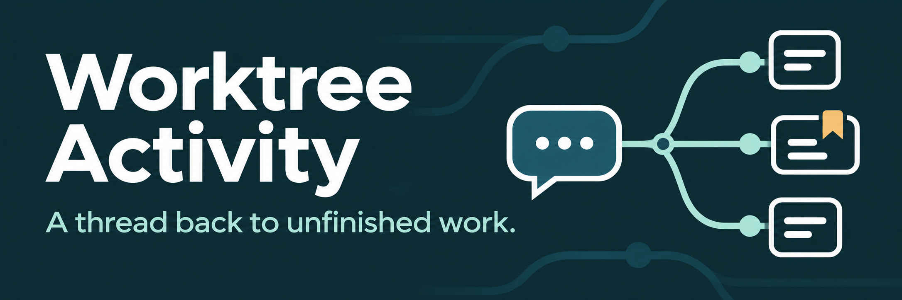

# Worktree Activity

**A thread back to unfinished work.**

When development stops halfway through, keep a clear route back to the Codex conversation responsible for finishing it. Worktree Activity records the assignment, progress, blockers, and verification in each target worktree so interrupted work remains attributable to its original user-facing coordinator.

- **Keep ownership through interruptions.** Records survive crashes, paused work, ended turns, and context compaction. They have no expiration.
- **Reconcile before you finish.** The responsible root retains its record until it verifies every task or records explicit user-authorized cancellation.
- **Coordinate several owners.** Independent root conversations keep separate records in a shared checkout; delegated workers report to their coordinator.
- **Find the next recovery step.** Read-only plans group unfinished work across projects by its responsible root, with native conversation links and visible discrepancies.

The [Worktree Activity skill](skills/worktree-activity/SKILL.md) ships with an executable helper, [JSON Schema](skills/worktree-activity/references/worktree-activity-v1.schema.json), [lifecycle/CLI contract](skills/worktree-activity/references/lifecycle.md), [runtime identity findings](skills/worktree-activity/references/runtime-identity.md), and [examples](skills/worktree-activity/examples/). It targets Codex and is intentionally excluded from the Copilot catalog. The portable plugin manifest remains included in the package.

## Install

Add the marketplace, then install the plugin:

```sh
codex plugin marketplace add sealad886/sealad886-codex-marketplace --ref main
codex plugin add worktree-activity@sealad886-codex-marketplace
```

Start a fresh Codex chat after installation. Complete the runtime setup below before asking the coordinator to register an assignment. For example:

> Use $worktree-activity:worktree-activity to register this assignment in its existing authorized worktree, retain ownership through interruptions, and finalize only after you verify all registered work.

For a local marketplace checkout, replace the first command with `codex plugin marketplace add /absolute/path/to/sealad886-codex-marketplace --json`. See [runtime identity findings](skills/worktree-activity/references/runtime-identity.md) for tested client versions and native discovery evidence.

## Runtime setup and activation

You need Python 3.11+, Git, a local filesystem supporting POSIX advisory file locks and atomic same-directory replacement, and the helper's pinned Python dependencies. Ordinary registry commands run offline. Dependency installation may use your configured package index.

Set `PLUGIN` to the installed or extracted plugin directory. Put the environment outside the immutable plugin/cache tree, in a location you control. For example, choose a project-specific environment path and run:

```sh
PLUGIN="/absolute/path/to/worktree-activity"
WORKTREE_ACTIVITY_ENV="/absolute/path/to/project/.venv-worktree-activity"
python3 -m venv "$WORKTREE_ACTIVITY_ENV"
"$WORKTREE_ACTIVITY_ENV/bin/python" -m pip install --require-hashes \
  -r "$PLUGIN/skills/worktree-activity/scripts/requirements.txt"
"$WORKTREE_ACTIVITY_ENV/bin/python" \
  "$PLUGIN/skills/worktree-activity/scripts/worktree_activity.py" --help
```

No global/system Python installation is required. Keep both paths available when invoking the helper; do not assume the shell starts in this marketplace or in the target worktree. Relocating the package works when you update `PLUGIN`.

Installation changes the selected Codex configuration. Enable the plugin, then inspect its available skill in a fresh chat. The skill permits implicit invocation, and its marketplace metadata targets Codex, but installation alone does not guarantee selection for every development assignment. Adopt the concise [AGENTS.md integration block](skills/worktree-activity/references/global-agents-integration.md) if you want a default instruction to load it before work. This package does not change global instructions, real client settings, or credentials automatically.

## Ordinary use

The target must already be an authorized, Git-registered linked worktree of its primary workspace. Existing linked worktrees outside the preferred primary workspace `.worktrees/` directory remain inspectable and can hold explicitly assigned work; the helper reports their unexpected placement as a warning. It rejects the primary checkout as a mutation target. New-worktree approval and placement rules remain independently applicable. The helper resolves checkout and branch metadata through Git; it never creates worktrees. These examples assume you are the responsible user-facing coordinator executing in Codex, with a native `CODEX_THREAD_ID` supplied by the runtime. Do not manually substitute another conversation's ID.

```sh
TARGET="/absolute/path/to/project/.worktrees/feature"
HELPER="$PLUGIN/skills/worktree-activity/scripts/worktree_activity.py"
PYTHON="$WORKTREE_ACTIVITY_ENV/bin/python"

"$PYTHON" "$HELPER" diagnostics --worktree "$TARGET"
"$PYTHON" "$HELPER" register --worktree "$TARGET" --coordinator \
  --surface codex-desktop --task-id implement-feature \
  --description "Implement and verify the requested feature"
"$PYTHON" "$HELPER" task --worktree "$TARGET" --coordinator \
  --task-id implement-feature --status in_progress
"$PYTHON" "$HELPER" task --worktree "$TARGET" --coordinator \
  --task-id implement-feature --status completed \
  --verification "Focused regression tests and the requested runtime check passed"
"$PYTHON" "$HELPER" finalize --worktree "$TARGET" --coordinator
```

Select `codex-cli` when that is the actual execution surface. `--coordinator` asserts your role; it is not a native role detector or authentication. Thread/session equality does not establish role. An independently assigned user-facing fork can own a separate record; a delegated subagent cannot.

Before dispatching a worker, the root registers its assigned task in the worker's target checkout. Add `--assignee-thread-id` when the native worker ID is available. The worker reports its results, and the root verifies them before completion. Optional assignee IDs never become recovery destinations.

Reads never refresh activity. Update after meaningful progress, blocker changes, or reconciled results. Keep records while blocked, paused, interrupted, awaiting approval, or ending a turn with work remaining. To cancel, use `--status canceled --cancellation-reason TEXT --authorization-ref TEXT` only after explicit user authorization. Finalization is a separate operation and refuses unfinished or unverified work.

## Storage and Git exclusion

```text
primary-workspace/.worktrees/feature/.agent-activity/
  <root-thread-id>.activity.json
  .<root-thread-id>.mutex
```

The `.activity.json` suffix identifies unfinished-work ownership. Stable mutex files synchronize registry writers and must remain in place. Do not unlink them during normal cleanup. The layout above illustrates the preferred placement; an existing linked worktree elsewhere uses the same `.agent-activity/` directory at its checkout root. Records contain last-reconciled checkout metadata, task descriptions, progress timestamps, and bounded result notes. Keep secrets, transcripts, and sensitive command output out of them.

Exclude registry artifacts from source control using the project's chosen exclusion policy. A project `.gitignore` rule named `.agent-activity/` covers these directories; alternatively, add that rule to the repository's shared Git exclude file after reviewing its current contents and the resolved `git rev-parse --git-path info/exclude` path. Do not overwrite existing excludes. The plugin does not edit exclusion files automatically.

## Inspection and recovery

Read-only commands work without Codex environment variables:

```sh
"$PYTHON" "$HELPER" inspect --worktree "$TARGET"
"$PYTHON" "$HELPER" validate "$TARGET/.agent-activity/<root-thread-id>.activity.json"
"$PYTHON" "$HELPER" scan "/absolute/path/to/project" --json \
  --max-worktrees 100 --max-records 1000
"$PYTHON" "$HELPER" recovery "/absolute/path/to/project" \
  "/absolute/path/to/another-project" --json
```

Supply primary workspace roots explicitly. Scans inspect their Git-registered linked worktrees, including legacy locations outside `.worktrees/`; they do not recursively discover unrelated projects. Scans are bounded and read only; partial results retain errors and return a failing exit status. Unexpected-placement warnings remain visible alongside findings. Recovery consolidates one target per `root_thread_id`, even across worktrees and projects, with unfinished tasks and discrepancies. Only the responsible root is a proposed recovery destination. Where verified, a native `codex://threads/<root-thread-id>` link opens that local chat. The helper never messages or resumes it.

There is no expiration or stale cleanup. An old record is recoverable evidence. No records does not imply a checkout can be deleted: independent Git-state, ownership, and approval checks still apply.

See the [verification receipt](skills/worktree-activity/references/verification.md) for completed checks and integration limits.

## Verification and contributing

From this marketplace checkout, reuse its project environment:

```sh
PYTHONDONTWRITEBYTECODE=1 .venv/bin/python -m unittest discover \
  -s tests -p 'test_worktree_activity.py' -v
PYTHONDONTWRITEBYTECODE=1 .venv/bin/python scripts/check_plugin.py \
  plugins/worktree-activity --layout source
PYTHONDONTWRITEBYTECODE=1 .venv/bin/python scripts/check_distribution_bundle.py \
  plugins/worktree-activity
PYTHONDONTWRITEBYTECODE=1 .venv/bin/python scripts/check_marketplace.py .
PYTHONDONTWRITEBYTECODE=1 .venv/bin/python scripts/check_copilot_marketplace.py .
```

Use disposable repositories and synthetic IDs for tests. Never scan unrelated projects, change global configuration, or message real chats. The runtime findings distinguish fixture coverage, observed Desktop identity, native discovery/installation, and unavailable integration checks. This cooperative local workflow does not authenticate against hostile processes running as the same OS user and does not lock source files against overlapping edits.
